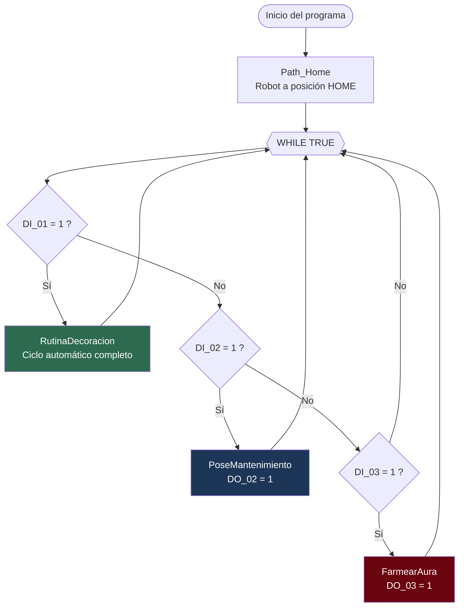
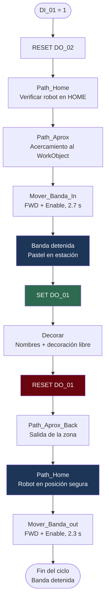
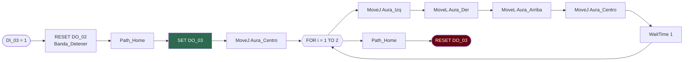
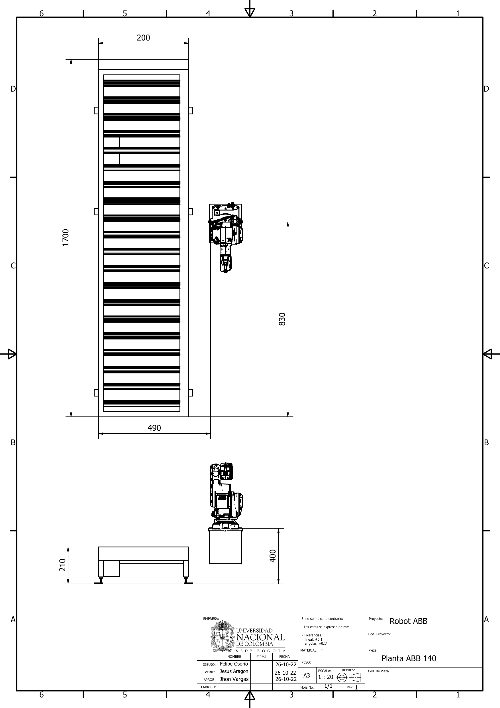
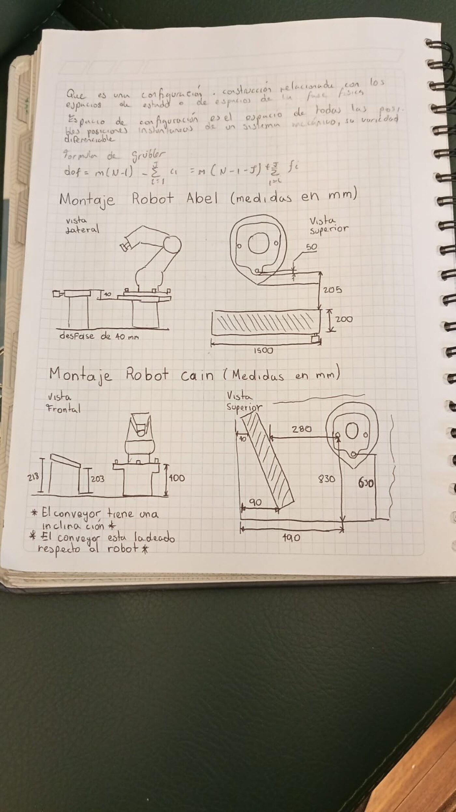
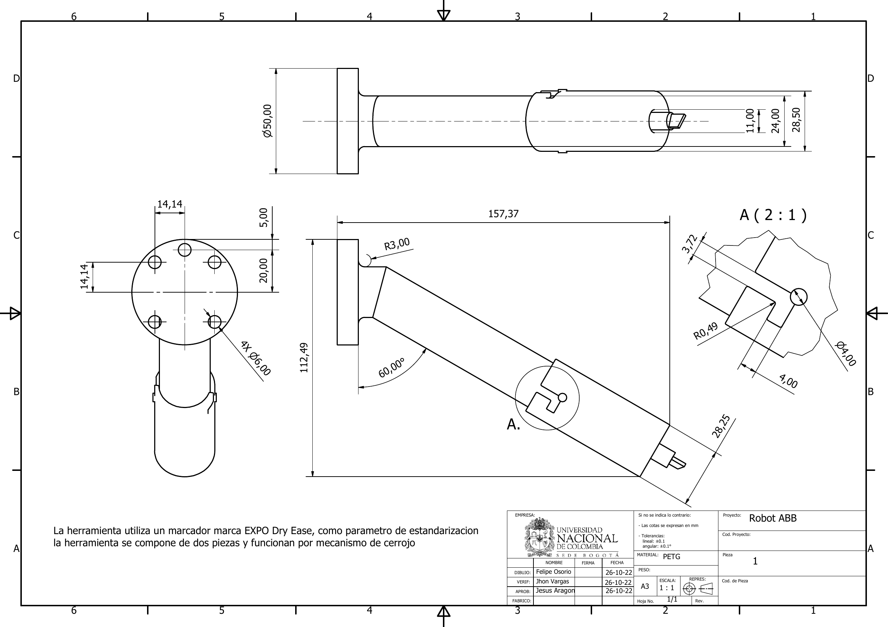
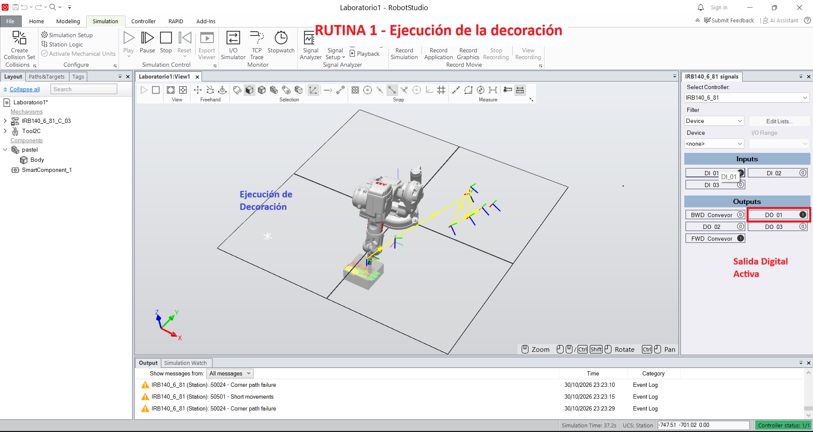
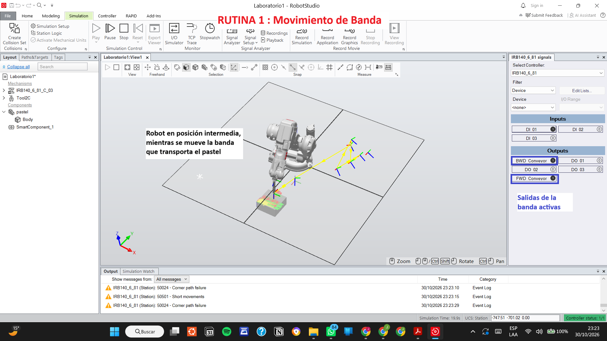
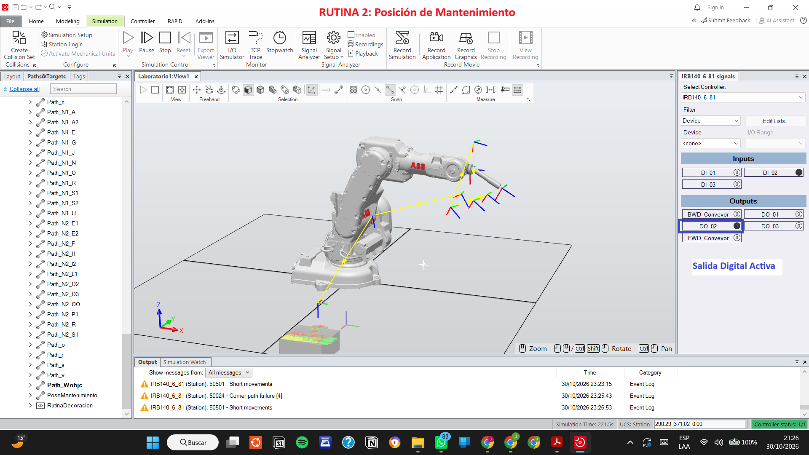
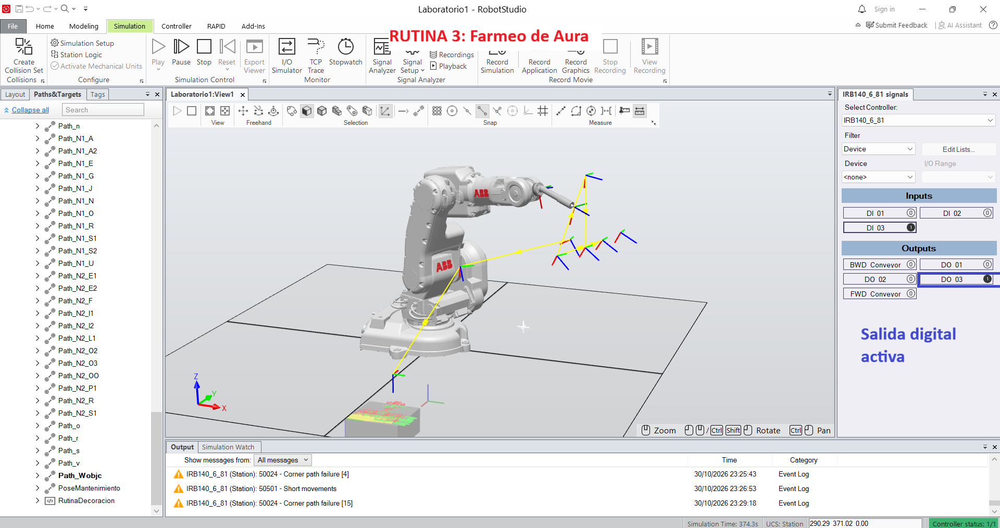

<div align="center">

<picture>
    <source srcset="https://imgur.com/5bYAzsb.png" media="(prefers-color-scheme: dark)">
    <source srcset="https://imgur.com/Os03JoE.png" media="(prefers-color-scheme: light)">
    
</picture>

<h3>Curso de Robótica 2026-II · Grupo 2C</h3>

<h1>Laboratorio No. 01<br>Robótica Industrial — Trayectorias, Entradas y Salidas Digitales</h1>

<h3>Decoración automática de pasteles con ABB IRB 140 y banda transportadora</h3>

<h4>Jesús Aragón · Felipe Osorio · Jhon Vargas</h4>

<p>
  
  
  
  
  
</p>

</div>

---

## Video de la práctica

<div align="center">

[](https://youtu.be/c02VIXdxSYY)

**[Demostración de Célula Robótica ABB — Laboratorio LabSIR](https://youtu.be/c02VIXdxSYY)**

*Publicado en el canal oficial del LabSIR UNAL*

</div>

---

## Contenido

| Carpeta | Contenido |
|---|---|
| [`rapid/`](./rapid) | Módulos RAPID: código final, calibración del TCP y versiones históricas |
| [`modelado/`](./modelado) | Modelo CAD de la herramienta (STEP, SAT, 3MF) |
| [`planta/`](./planta) | Plano de planta de la celda y boceto de levantamiento |
| [`analisis/`](./analisis) | Scripts de verificación de la calibración y de los WorkObjects |
| [`evidencias/`](./evidencias) | Capturas del simulador con el estado de las señales digitales |

---

## 1. Descripción de la solución

Se implementó una celda simplificada para la **decoración automática de un pastel** usando un manipulador **ABB IRB 140** con controlador **IRC5**, una **banda transportadora** accionada por variador de frecuencia y un módulo de entradas y salidas digitales **DSQC 652**.

El pastel se representa mediante una superficie plana rectangular con acabado borrable, dimensionada para una torta de aproximadamente 20 personas, que se ubica sobre la banda transportadora. La banda lo traslada hasta la estación de decoración, se detiene por completo, el robot dibuja con un marcador los nombres de los tres integrantes más un elemento decorativo libre, y una vez el robot regresa a HOME la banda evacúa el pastel decorado hasta el extremo final.

El sistema ofrece **tres modos de operación** seleccionables por entrada digital, cada uno con su salida indicadora de estado. La lógica reside en un bucle infinito en `main` que sondea las tres entradas y garantiza por construcción que la banda nunca se mueva mientras el robot está dentro de la zona de interacción.

### Elementos de la celda

- Manipulador ABB IRB 140 (6 GDL, carga 6 kg).
- Controlador IRC5 con módulo de E/S digitales DSQC 652.
- Banda transportadora bidireccional con variador de frecuencia.
- Herramienta porta-marcador de diseño propio, fijada al flange.
- Superficie de trabajo borrable ("pastel").

---

## 2. Diagrama de flujo

### 2.1. Lógica general de operación



### 2.2. Ciclo automático de decoración (DI_01)



El enclavamiento de seguridad es estructural: el robot solo entra a decorar después de que `Mover_Banda_In` ha retirado la señal de habilitación de la banda, y la banda solo vuelve a arrancar después de que `Path_Home` ha devuelto el robot a la posición segura.

### 2.3. Rutina Farmear Aura (DI_03)



---

## 3. Plano de planta

Levantamiento dimensional de la celda del robot **Cain** (IRB 140 con banda transportadora), realizado en Autodesk Inventor a partir de las medidas tomadas en el laboratorio.

<div align="center">



*Plano de planta de la celda. Versión imprimible: [`Plano_de_Planta.pdf`](./planta/Plano_de_Planta.pdf)*

</div>

| Dimensión | Valor (mm) |
|---|---|
| Longitud de la banda transportadora | 1700 |
| Ancho de la banda transportadora | 200 |
| Altura de la mesa de la banda | 210 |
| Altura del pedestal del robot | 400 |
| Distancia del eje del robot al extremo cercano de la banda | 830 |
| Distancia del eje del robot al extremo opuesto de la banda | 490 |

La banda está dispuesta **ladeada respecto al robot**, no paralela a los ejes de la base, y su superficie presenta una ligera inclinación. Esto es justamente lo que obliga al ajuste de 3° del plano de trabajo descrito en la [sección 5](#ajuste-del-plano-de-trabajo).

<div align="center">



*Boceto de campo con las medidas de los montajes de los robots Abel y Cain*

</div>

### Coordenadas de los elementos

Las coordenadas de los elementos de la celda, referidas al sistema de la base del robot y obtenidas de la definición de los `robtarget` y de los `wobjdata` del módulo, son:

| Elemento | Posición (mm, base del robot) |
|---|---|
| Origen del robot | `[0, 0, 0]` |
| HOME | `[607.6, -3.0, 526.5]` |
| Pose de mantenimiento | `[830.4, -75.7, 591.2]` |
| Aproximación a la banda | `[414.3, -723.6, 591.2]` |
| WorkObject A (superficie frontal) | origen `[700.0, -110.0, 150.0]` |
| WorkObject B (estación sobre la banda) | origen `[566.7, -168.2, 328.8]` |
| Centro de la coreografía Farmear Aura | `[738.1, -252.8, 567.6]` |

---

## 4. Herramienta

### 4.1. Diseño

La herramienta es un soporte porta-marcador fijado al flange del IRB 140, fabricado en **PETG** por impresión 3D. Está compuesta por **dos piezas que se unen mediante un mecanismo de cerrojo**, lo que permite retirar y reemplazar el marcador sin desmontar la brida del robot. El diseño se estandarizó para un marcador **EXPO Dry Erase**.

<div align="center">



*Plano de fabricación de la herramienta porta-marcador. Versión imprimible: [`Plano_de_Fabricacion.pdf`](./modelado/Plano_de_Fabricacion.pdf)*

</div>

### Dimensiones principales

| Característica | Valor |
|---|---|
| Diámetro de la brida de montaje | Ø50.00 mm |
| Espesor de la brida | 5.00 mm |
| Agujeros de fijación | 4 × Ø6.00 mm, distribución 14.14 × 14.14 mm |
| Longitud total | 157.37 mm |
| Altura del conjunto | 112.49 mm |
| Ángulo del cuerpo respecto a la brida | 60.00° |
| Diámetro de alojamiento del marcador | Ø4.00 mm |
| Material | PETG |
| Tolerancias | lineal ±0.1 mm, angular ±0.1° |

La inclinación de 60° del cuerpo respecto al plano de la brida es coherente con la rotación de 30° alrededor del eje Y declarada en el `tooldata`, que corresponde al mismo ángulo medido desde el eje de la herramienta.

Modelos CAD disponibles en [`modelado/`](./modelado): `gripperLab1.3mf`, `gripper pieza.sat`, `gripper pieza - Part 4.step`, `Assembly 1.step`, `Tapa.stp`.

Los tornillos de fijación se seleccionaron de modo que su longitud no excediera la suma del espesor del flange más el espesor de la brida de la herramienta, según la indicación dada para la práctica.

### 4.2. Técnica de calibración del TCP

Se empleó el método de **4 puntos** disponible en el FlexPendant. El criterio para elegirlo fue que la herramienta es un marcador de punta definida y no requiere orientación de herramienta independiente del punto de contacto, por lo que basta determinar la posición del TCP sin reorientar los ejes de la herramienta. El procedimiento consiste en aproximar la punta del marcador a un mismo punto fijo del espacio con cuatro orientaciones del manipulador claramente distintas; el controlador resuelve entonces el sistema de ecuaciones que determina la posición del TCP respecto al flange.

Los cuatro puntos registrados están en [`rapid/TCP_tool2C.txt`](./rapid/TCP_tool2C.txt).

### 4.3. Comparación: robot real vs. RobotStudio

El objeto `tooldata` definido en el módulo es:

```rapid
PERS tooldata Tool2C := [TRUE, [[81.849, -2.987, 164.221],
                                [0.965925826, 0, 0.258819045, 0]],
                               [1, [0, 0, 1], [1, 0, 0, 0], 0, 0, 0]];
```

La orientación corresponde a una inclinación de 30° alrededor del eje Y de la herramienta, y la masa declarada es de 1 kg.

Para verificar la calibración se resolvió de forma independiente el sistema de mínimos cuadrados que plantea el método de 4 puntos. Si **p** es el TCP en coordenadas del flange y **c** el punto fijo tocado, cada pose registrada debe cumplir:

```
t_i + R_i · p = c        para i = 1 … 4
```

donde `t_i` y `R_i` son la posición y la orientación del flange en cada pose. El script [`analisis/calcular_tcp.py`](./analisis/calcular_tcp.py) reproduce el cálculo.

| | X (mm) | Y (mm) | Z (mm) | Norma |
|---|---|---|---|---|
| TCP calculado desde los 4 puntos | 83.356 | 1.045 | 165.397 | 185.217 |
| `Tool2C` definido en RobotStudio | 81.849 | −2.987 | 164.221 | 183.512 |
| **Diferencia** | **+1.507** | **+4.032** | **+1.176** | **4.462** |

**Calidad del ajuste.** Residuo de cada punto respecto al punto de contacto común:

| Punto | Error (mm) |
|---|---|
| `pTCP_Point1` | 3.248 |
| `pTCP_Point2` | 1.848 |
| `pTCP_Point3` | 2.286 |
| `pTCP_Point4` | 2.252 |
| **Media** | **2.409** |
| **Máximo** | **3.248** |
| **RMS** | **2.463** |

El punto fijo de contacto quedó determinado en `[524.71, −18.80, 440.27]` mm.

**Condicionamiento.** La variación angular entre las cuatro orientaciones empleadas va de 23.2° a 73.8°, y el número de condición del sistema de mínimos cuadrados es 11.2. El problema está por tanto bien condicionado: la diversidad de orientaciones es suficiente para determinar el TCP de forma unívoca, y el residuo observado corresponde a error de medición físico, no a una degeneración numérica del ajuste.

### 4.4. Análisis de las diferencias

La discrepancia de 4.462 mm entre el TCP medido en el robot real y el definido en RobotStudio admite las siguientes causas:

1. **La desviación es lateral, no axial.** La diferencia se concentra en el eje Y (+4.032 mm), mientras X y Z coinciden dentro de 1.5 mm, y la longitud total del TCP solo difiere 1.705 mm. Esto indica que el eje del marcador no coincide exactamente con el eje nominal previsto en el modelo CAD, lo que es consistente con la tolerancia de alojamiento de una pieza fabricada por impresión 3D y con el juego del marcador dentro de su soporte.

2. **Deformación del elemento de contacto.** La punta del marcador es flexible y se deforma al apoyarse contra la superficie de referencia durante el registro de los puntos, de modo que el punto de contacto efectivo varía ligeramente con la orientación del robot.

3. **Posicionamiento manual.** Los cuatro puntos se registraron mediante jogging manual, aproximando visualmente la punta al mismo punto físico. El residuo medio de 2.409 mm es coherente con la resolución alcanzable por este procedimiento.

4. **Modelo ideal frente a montaje real.** En RobotStudio la herramienta se ubica según la geometría exacta del CAD, sin holguras ni tolerancias de ensamblaje, mientras el montaje físico incorpora el error de los tornillos de fijación y la perpendicularidad real de la brida.

Esta diferencia explica a posteriori el ajuste iterativo del `oframe` del WorkObject que se observa en el histórico de versiones del módulo (altura corregida de −204.15 a −228.84 mm y una pequeña inclinación añadida): el error residual del TCP se compensó en la definición del sistema de coordenadas de trabajo para lograr un trazo uniforme sobre la superficie.

---

## 5. WorkObject: reutilización de trayectorias

La rutina de decoración se programó íntegramente respecto a un **WorkObject** propio, distinto de `wobj0`. Los 89 puntos de la trayectoria están expresados en coordenadas de ese sistema de referencia, de modo que la posición en el mundo se obtiene por composición en tiempo de ejecución:

```
posición en el mundo = uframe ∘ oframe ∘ coordenada del punto
```

Esto permite trasladar y rotar la trayectoria completa como un cuerpo rígido sin modificar ningún `robtarget`. Para demostrarlo, la misma rutina se ejecutó en dos ubicaciones distintas de la celda:

| | WorkObject A | WorkObject B |
|---|---|---|
| Archivo | [`rapid/historico/Module1_wobjA.txt`](./rapid/historico/Module1_wobjA.txt) | [`rapid/Module1_final.txt`](./rapid/Module1_final.txt) |
| Ubicación | Superficie frontal al robot | Estación sobre la banda transportadora |
| `uframe` | `[700, −110, 150]` | `[570, −110, 100]` |
| `oframe` | identidad | `[3.26, −58.17, −228.84]` + rotación |
| Origen efectivo | `[700.0, −110.0, 150.0]` | `[566.7, −168.2, 328.8]` |
| Recorrido en X | 485.6 … 609.3 mm | 363.2 … 540.8 mm |
| Recorrido en Y | −84.0 … +93.6 mm | −382.1 … −258.7 mm |
| Recorrido en Z | 148.0 mm (plano) | 315.6 … 322.1 mm (plano) |

La **rotación relativa entre ambos WorkObjects es de 90.0°** y el origen se desplazó `[−133.3, −58.2, +178.8]` mm. El WorkObject B corresponde a la estación de decoración sobre la banda, a una altura de trabajo de unos 320 mm.

Verificación realizada con [`analisis/comparar_workobjects.py`](./analisis/comparar_workobjects.py): los **89 `robtarget` de la trayectoria son idénticos en ambos módulos**, lo que confirma que únicamente se modificó el sistema de coordenadas de referencia. El WorkObject sobre la banda se definió con el robot real: se llevó manualmente la herramienta hasta el punto que debía servir de origen del sistema de referencia y esa pose se registró para disponer de ella en el programa RAPID. La orientación no se dedujo de la geometría de la banda, sino que se eligió de modo que la aproximación del marcador al plano de trabajo quedara dentro de una configuración alcanzable por el manipulador. El WorkObject de la simulación se reubicó después en esa misma pose.

### Ajuste del plano de trabajo

Durante las pruebas con el robot real se comprobó que la superficie de la banda no era paralela al plano definido inicialmente para las trayectorias, por lo que el marcador no mantenía contacto uniforme a lo largo del trazo.

La corrección se aplicó sobre la orientación del `oframe` del WorkObject, sin modificar ningún punto de la trayectoria:

| | `oframe` |
|---|---|
| Definición inicial | `[3.26, −52.16, −210.15]`, sin inclinación |
| Definición corregida | `[3.26, −58.17, −228.84]`, con inclinación |

La rotación introducida entre ambas definiciones es de **3.000° alrededor del eje X** del WorkObject, acompañada de un ajuste de 18.69 mm en la altura del plano. Al aplicarse sobre el sistema de referencia y no sobre los puntos, la compensación afecta por igual a los 89 `robtarget` de la decoración.

---

## 6. Entradas y salidas digitales

### 6.1. Modos de operación

| Entrada | Rutina | Salida indicadora | Significado de la salida |
|---|---|---|---|
| `DI_01` | `RutinaDecoracion` | `DO_01` | Activa exclusivamente mientras el robot ejecuta las trayectorias de decoración |
| `DI_02` | `PoseMantenimiento` | `DO_02` | Robot en posición de mantenimiento |
| `DI_03` | `FarmearAura` | `DO_03` | Robot ejecutando la rutina Farmear Aura |

La pose de mantenimiento, en `[830.4, −75.7, 591.2]`, deja la herramienta accesible para instalar o retirar el marcador y para la inspección visual del soporte.

### 6.2. Control de la banda transportadora

El variador de frecuencia de la banda disponible en el laboratorio se comanda mediante un esquema de **dirección más habilitación**, no mediante dos señales de sentido independientes:

| Señal | Función real en la celda |
|---|---|
| `FWD_Conveyor` | Selección del sentido de giro |
| `BWD_Conveyor` | Habilitación del motor |

De ahí que los procedimientos de movimiento fijen primero el sentido y después habiliten el accionamiento:

```rapid
PROC Mover_Banda_In()
    SET FWD_Conveyor;    ! Sentido de avance
    SET BWD_Conveyor;    ! Habilitar motor
    WaitTime 2.7;
    RESET BWD_Conveyor;  ! Deshabilitar: la banda se detiene
ENDPROC

PROC Mover_Back()
    RESET FWD_Conveyor;  ! Sentido contrario
    SET BWD_Conveyor;    ! Habilitar motor
    WaitTime 2.7;
    RESET BWD_Conveyor;
ENDPROC

PROC Banda_Detener()
    RESET BWD_Conveyor;  ! Deshabilitar motor
ENDPROC
```

Con esta configuración **el enclavamiento contra la activación simultánea de ambos sentidos queda garantizado por construcción**: al existir una única señal de dirección es físicamente imposible ordenar los dos sentidos de giro a la vez. La inversión de sentido se realiza siempre con el motor deshabilitado, de modo que la banda se detiene antes de cualquier cambio de dirección.

La posición de la estación de decoración se determinó **por tiempo de desplazamiento**, medido experimentalmente: 2.7 s para la entrada del pastel a la estación y 2.3 s para la evacuación hasta el extremo final de la banda.

### 6.3. Evidencia de funcionamiento

Capturas del simulador con el panel de E/S del controlador `IRB140_6_81`, tomadas durante la ejecución de cada rutina. En conjunto documentan las ocho señales de la celda:

| | |
|---|---|
| <br>**Rutina 1 — Decoración.** `DI_01 = 1` y `DO_01 = 1` mientras el robot traza la decoración sobre el pastel. | <br>**Rutina 1 — Movimiento de banda.** `FWD_Conveyor = 1` y `BWD_Conveyor = 1` de forma simultánea: sentido seleccionado y motor habilitado. |
| <br>**Rutina 2 — Posición de mantenimiento.** `DI_02 = 1` y `DO_02 = 1` con el robot en la pose de acceso a la herramienta. | <br>**Rutina 3 — Farmear Aura.** `DI_03 = 1` y `DO_03 = 1` durante la ejecución de la rutina libre. |

La captura de la banda confirma el esquema descrito en 6.2: ambas señales de la banda aparecen activas al mismo tiempo porque no representan dos sentidos de giro, sino dirección y habilitación.

El ciclo completo, con el movimiento bidireccional de la banda y el trazo real sobre el pastel, se documenta en el [video de la práctica](https://youtu.be/c02VIXdxSYY).

---

## 7. Instrucciones y funciones de RAPID utilizadas

### 7.1. Movimiento

| Instrucción | Usos | Función en la solución |
|---|---|---|
| `MoveL` | 243 | Trazos rectos de las letras y segmentos de la decoración; también la entrada y salida vertical del marcador |
| `MoveJ` | 140 | Reposicionamientos entre letras, aproximaciones y coreografía |
| `MoveC` | 47 | Arcos de las letras curvas (S, O, G, C) para mantener el trazo continuo |

Velocidades empleadas: `v100` y `v200`, dentro del rango exigido de `v100` a `v1000`. Zonas: `z10`, `z1` y `fine`, sin exceder la zona máxima permitida `z10`.

### 7.2. Funciones y datos

| Elemento | Uso |
|---|---|
| `Offs(punto, dx, dy, dz)` | 22 usos. Genera los puntos de entrada y salida de cada trazo desplazando el punto base en Z, sin declarar puntos adicionales |
| `Target_Aux.trans.z` | Modificación directa del componente Z de un `robtarget` para el mismo propósito, operando sobre una variable auxiliar |
| `Alt_M` | Variable numérica (−10 mm) que define la altura de despegue del marcador respecto a la superficie |
| `tooldata` | `Tool2C`, herramienta porta-marcador calibrada |
| `wobjdata` | `Workobject_1`, sistema de coordenadas de la superficie de decoración |
| `robtarget` | 230 puntos declarados, de los cuales 89 definen la trayectoria de decoración |

### 7.3. Señales digitales y control de flujo

| Instrucción | Usos | Función |
|---|---|---|
| `SET` / `Set` | 23 | Activación de `DO_01`, `DO_02`, `DO_03`, `FWD_Conveyor` y `BWD_Conveyor` |
| `RESET` / `Reset` | 14 | Desactivación de las mismas señales |
| `WaitTime` | 13 | Temporización del desplazamiento de la banda y espera de parada completa |
| `WHILE` | 2 | Bucle principal de sondeo de entradas en `main` |
| `IF` | 6 | Selección del modo de operación según la entrada activa |
| `FOR` | 2 | Repetición de la coreografía en `FarmearAura` |

La estructura de programación intermedia exigida para la rutina Farmear Aura se cumple mediante el ciclo `FOR` que repite dos veces la secuencia de cuatro poses, combinando movimientos `MoveJ` y `MoveL`.

### 7.4. Organización en procedimientos

El módulo se estructura en unos 170 procedimientos. La decoración se descompone en un procedimiento por letra (`Path_N1_J`, `Path_N1_E`, … `Path_N2_O3`) y procedimientos por elemento decorativo (`Path_cohete`), que el procedimiento `Decorar` encadena. Esta descomposición permite depurar y reproducir letras individuales durante la puesta en marcha sin ejecutar la trayectoria completa.

---

## 8. Código RAPID

El código completo está en [`rapid/Module1_final.txt`](./rapid/Module1_final.txt) (1254 líneas).

### Estructura del módulo

```
MODULE Module1
├── Declaraciones
│   ├── Workobject_1 .............. wobjdata de la superficie de decoración
│   ├── Tool2C .................... tooldata de la herramienta porta-marcador
│   ├── Target_Home, Target_Mant .. poses en wobj0
│   ├── Aura_Centro/Izq/Der/Arriba  poses de la coreografía
│   └── 230 robtarget ............. puntos de las letras y la decoración
│
├── Control
│   ├── main() .................... bucle de sondeo de DI_01, DI_02, DI_03
│   ├── RutinaDecoracion() ........ ciclo automático completo
│   ├── PoseMantenimiento() ....... desplazamiento a la pose de servicio
│   └── FarmearAura() ............. coreografía con ciclo FOR
│
├── Banda transportadora
│   ├── Mover_Banda_In() .......... transporte hacia la estación
│   ├── Mover_Banda_out() ......... evacuación del pastel decorado
│   ├── Mover_Back() .............. sentido inverso
│   └── Banda_Detener() ........... deshabilitación del motor
│
├── Posicionamiento
│   ├── Path_Home() ............... retorno a HOME
│   ├── Path_Aprox() .............. aproximación al WorkObject
│   └── Path_Aprox_Back() ......... retirada de la zona de interacción
│
└── Trayectorias
    ├── Decorar() ................. encadena todos los trazos
    ├── Path_N1_* ................. letras del primer nombre
    ├── Path_N2_* ................. letras del segundo nombre
    ├── Path_[a-z] ................ letras del tercer nombre
    └── Path_cohete() ............. elemento decorativo
```

### Versiones históricas

En [`rapid/historico/`](./rapid/historico) se conservan las versiones previas del módulo, que documentan la evolución del desarrollo:

- `Module1_Cain_09_10.txt` — primera versión funcional con las trayectorias del primer nombre, sin integración de señales digitales ni banda transportadora.
- `Module1_wobjA.txt` — versión con el WorkObject en la superficie frontal al robot, empleada para demostrar la reutilización de la trayectoria. Incluye `ConfJ\Off`, `ConfL\Off` y `SingArea\Wrist` para resolver las restricciones de configuración de ejes en esa ubicación.

---

<div align="center">

**Universidad Nacional de Colombia** · Facultad de Ingeniería · Ingeniería Mecatrónica

Robótica 2026-II · Laboratorio LabSIR

</div>
