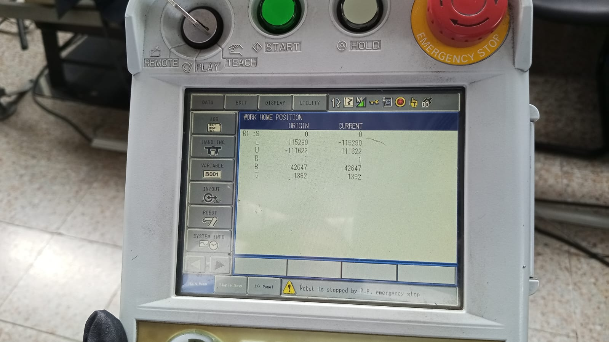
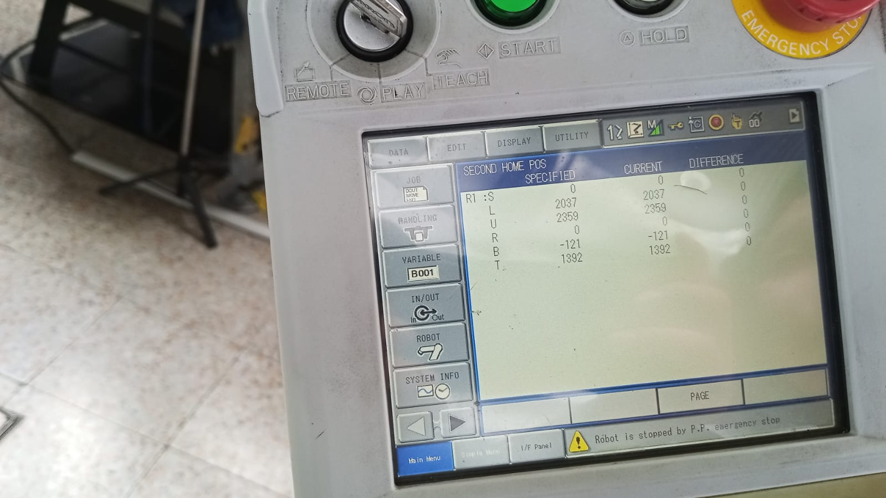
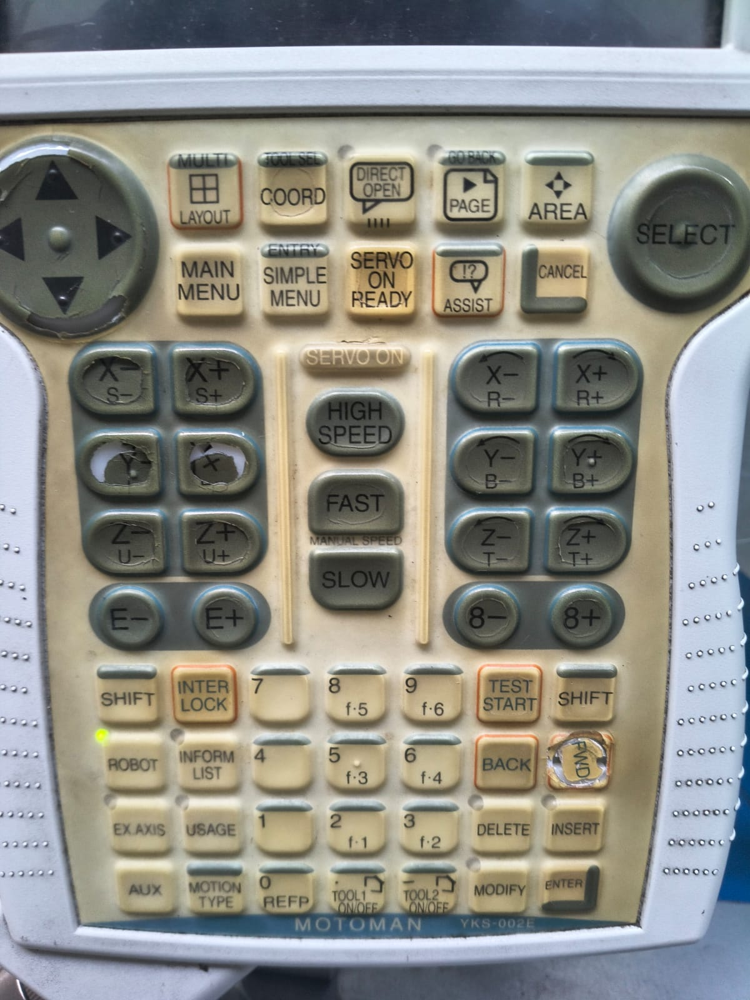
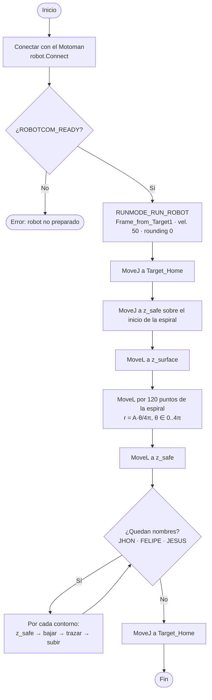
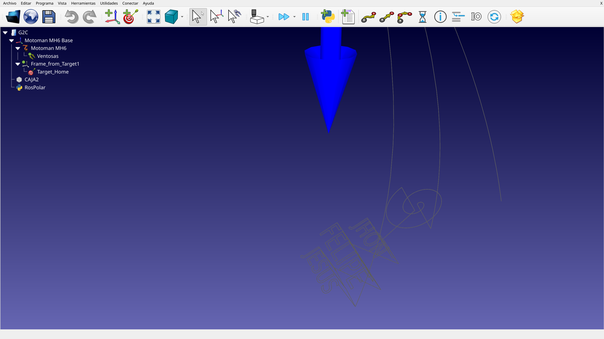

<picture>
    <source srcset="https://imgur.com/5bYAzsb.png" media="(prefers-color-scheme: dark)">
    <source srcset="https://imgur.com/Os03JoE.png" media="(prefers-color-scheme: light)">
    
</picture>

<h3>Curso de Robótica 2026-II · Grupo 2C</h3>

<h1>Laboratorio No. 02 Robótica Industrial — Análisis y Operación del Manipulador Motoman MH6</h1>

<h3>Trayectoria polar con RoboDK y ejecución en el Motoman MH6</h3>

<h4>Jesús Aragón · Felipe Osorio · Jhon Vargas</h4>

  
  
  

---

## Video de la práctica

**[Laboratorio 02 — Motoman MH6 y RoboDK](https://youtu.be/gj03LV87VvU)**

*Simulación en RoboDK y ejecución en el manipulador físico comandado desde el PC*

---

## Contenido

| Carpeta | Contenido |
|---|---|
| [`codigo/`](./codigo) | `RosPolar.py` (ejecución en el robot físico) y `RosPolar_sim.py` (solo simulación) |
| [`evidencias/`](./evidencias) | Capturas del teach pendant (home1, home2, teclado) y de la trayectoria simulada |

---

## 1. Cuadro comparativo: Motoman MH6 vs ABB IRB 140

| Característica | Yaskawa Motoman MH6 | ABB IRB 140 |
|---|---|---|
| Grados de libertad | 6 | 6 |
| Carga máxima | 6 kg | 6 kg |
| Alcance horizontal | 1422 mm | 810 mm |
| Repetibilidad | ±0.08 mm | ±0.03 mm |
| Masa del manipulador | 130 kg | 98 kg |
| Vel. máx. eje 1 (S / 1) | 220 °/s | 200 °/s |
| Vel. máx. eje 2 (L / 2) | 200 °/s | 200 °/s |
| Vel. máx. eje 3 (U / 3) | 220 °/s | 260 °/s |
| Vel. máx. eje 4 (R / 4) | 410 °/s | 360 °/s |
| Vel. máx. eje 5 (B / 5) | 410 °/s | 360 °/s |
| Vel. máx. eje 6 (T / 6) | 610 °/s | 450 °/s |
| Rango eje 1 (S / 1) | −170° a +170° | 360° (recorrido total) |
| Rango eje 2 (L / 2) | −90° a +155° | 200° (recorrido total) |
| Rango eje 3 (U / 3) | −175° a +250° | 280° (recorrido total) |
| Rango eje 4 (R / 4) | −180° a +180° | Ilimitado (400° por defecto) |
| Rango eje 5 (B / 5) | −45° a +225° | 230° (recorrido total) |
| Rango eje 6 (T / 6) | −360° a +360° | Ilimitado (800° por defecto) |
| Controlador | DX100 | IRC5 |
| Teach pendant | YKS-002E | FlexPendant |
| Lenguaje | INFORM | RAPID |
| Aplicaciones típicas | Soldadura por arco, ensamble, dispensado, moldeo por inyección, atención de máquinas, manipulación de material, empaque | Soldadura por arco, ensamble, limpieza/pintura, desbarbado, atención de máquinas, manipulación de material, empaque |

*Fuentes: [Yaskawa, MOTOMAN MH6 Datasheet](https://assets.robots.com/robots/Motoman/Handling/MOTOMAN_MH6_Datasheet.pdf) · [ABB, IRB 140 (2021)](https://library.e.abb.com/public/0ab091987347463cb06a3cc653d8ddb8/IRB_140_20211001.pdf) · [ABB, IRB 140 Data sheet](https://library.e.abb.com/public/584dbcbf0dcd7372c1257b44005237fc/Data%20sheet%20IRB%20140%20Jan%2002.pdf).*

---

## 2. Posiciones home del Motoman MH6

El controlador guarda dos posiciones de referencia. Los valores se leen en el teach pendant y están en **pulsos de encoder** por eje.

| Eje | Home 1 · *Work Home Position* | Home 2 · *Second Home Pos* |
|---|---|---|
| S | 0 | 0 |
| L | −115290 | 2037 |
| U | −111622 | 2359 |
| R | 1 | 0 |
| B | 42647 | −121 |
| T | 1392 | 1392 |

 

- **Home 2** tiene todos los ejes prácticamente en cero: coincide con la posición de calibración del robot.
- **Home 1** tiene los ejes L, U y B lejos del cero.

Consideramos mejor el **Second Home**, porque está prácticamente en la posición cero del robot, la referencia de calibración de los ejes. Es la posición desde la que el programa de la trayectoria polar arranca y a la que regresa (`Target_Home`, 0° en las seis articulaciones).

---

## 3. Movimiento manual

Procedimiento con el teach pendant YKS-002E:

1. Selector de modo en **TEACH**.
2. Pulsar **SERVO ON READY** y mantener presionado el *enable switch* de la parte posterior del pendant.
3. Elegir el sistema de coordenadas con **COORD**: articular, cartesiano (base / robot), usuario o herramienta. Con **SHIFT + COORD** (*TOOL SEL*) se selecciona la herramienta.
4. Mover con las teclas de eje:

| Teclas | Modo articular | Modo cartesiano |
|---|---|---|
| X−/X+ (S−/S+) | Eje S | Traslación en X |
| Y−/Y+ (L−/L+) | Eje L | Traslación en Y |
| Z−/Z+ (U−/U+) | Eje U | Traslación en Z |
| X−/X+ (R−/R+), flechas curvas | Eje R | Rotación alrededor de X |
| Y−/Y+ (B−/B+), flechas curvas | Eje B | Rotación alrededor de Y |
| Z−/Z+ (T−/T+), flechas curvas | Eje T | Rotación alrededor de Z |
| E−/E+, 8−/8+ | Ejes externos | Ejes externos |

---

## 4. Niveles de velocidad en movimiento manual

El DX100 tiene **cuatro niveles** de velocidad manual, que también aplican a la ejecución paso a paso con FWD / BWD:

| Nivel | Abreviatura | Ícono |
|---|---|---|
| Inching | INCH | Letra **I**, sin barras verdes |
| Low (lenta) | SLW | Letra **L**, 1 barra verde |
| Medium (media) | MED | Letra **M**, 2 barras verdes |
| High (rápida) | FST | Letra **H**, 3 barras verdes |

- Cada pulsación de **FAST** sube un nivel: INCH → SLW → MED → FST.
- Cada pulsación de **SLOW** baja un nivel: FST → MED → SLW → INCH.
- **HIGH SPEED**, presionada junto con una tecla de eje, mueve el robot a una velocidad alta predefinida mientras se mantiene, sin cambiar el nivel seleccionado. Queda deshabilitada en INCH.
- En operación manual, la velocidad del punto central de la herramienta está limitada a 250 mm/s.

El nivel activo se muestra en la **barra de estado** de la parte superior de la pantalla del pendant, como el tercer ícono desde la izquierda. En las fotos de las posiciones home se ve el ícono **M**, es decir, velocidad media.

*Fuente: Yaskawa, DX100 Operator's Manual 155507-1CD, secciones 1.2.3, 1.2.4.4 y 2.2.0.5.*

---

## 5. RoboDK

### 5.1. Aplicaciones principales

- Simulación de celdas robóticas y verificación de alcance, colisiones y singularidades.
- Programación offline: trayectorias definidas en la estación o por la API de Python.
- Post-procesado: traduce el programa al lenguaje del fabricante (en este caso INFORM de Yaskawa).
- Ejecución en línea: mueve el robot real desde el PC mediante un driver.

### 5.2. Comunicación con el Motoman

En la estación `G2C` el robot está configurado así:

| Parámetro | Valor |
|---|---|
| Driver | `MotomanHSE` (Motoman High Speed Ethernet) |
| IP del controlador | 192.168.1.20 |
| Usuario | `rcmaster` |

RoboDK usa el protocolo **High-Speed Ethernet Server (HSE)** de Yaskawa, disponible en el DX100 sin opciones adicionales (firmware 2.7.00 o superior). Con él, el PC mueve y monitorea el robot por TCP/IP a unos 70 Hz. Para que el controlador acepte los comandos, el selector del teach pendant debe estar en **REMOTE**.

En este modo RoboDK trabaja con un **driver**, no con un post-procesador: no genera un programa INFORM para cargarlo al controlador, sino que envía cada movimiento (`MOVJ`, `MOVL`) en línea y espera la confirmación del robot antes de mandar el siguiente. Así, el robot real sigue a la simulación paso a paso.

En el script esto se hace con `robot.Connect()`, que abre la conexión con el driver; `robot.ConnectedState()`, que comprueba que el robot esté listo; y `RDK.setRunMode(RUNMODE_RUN_ROBOT)`, que hace que cada `MoveJ` / `MoveL` de la API se ejecute en el robot físico. Con `RUNMODE_SIMULATE` los mismos comandos solo mueven el modelo en RoboDK.

La otra forma de usar RoboDK con el Motoman es la programación offline: el post-procesador genera archivos JBI (INFORM) que se transfieren al controlador y se ejecutan desde el pendant, sin el driver.

---

## 6. RoboDK vs RobotStudio

| Aspecto | RoboDK | RobotStudio |
|---|---|---|
| Fabricantes | Multimarca (ABB, Yaskawa, KUKA, Fanuc, UR, …) | Solo ABB |
| Simulación del controlador | Modelo cinemático genérico | Controlador virtual IRC5/OmniCore idéntico al real |
| Programación | Python (API) y post-procesadores por marca | RAPID nativo |
| Ejecución en el robot | Driver en línea o programa post-procesado | Carga directa del módulo RAPID al controlador |
| Licencia | Comercial, con modo gratuito limitado | Comercial, con licencia educativa |
| Uso típico | Celdas con robots de distintas marcas, mecanizado, programación rápida con Python | Puesta a punto exacta de celdas ABB, E/S, tiempos de ciclo |

### ¿Qué significa para nosotros cada herramienta?

Preferimos RoboDK por dos razones. Primero, se puede programar en Python y conectarse a él desde afuera, así que se trabaja en un IDE aparte, lo que lo hace más versátil. Segundo, tiene una librería de robots muy amplia. En general es el programa que más nos gusta.

Aun así, en la industria, para trabajar directamente con robots ABB, seguramente siempre será mejor usar su propio software, RobotStudio, por confiabilidad y compatibilidad.

---

## 7. Diagrama de flujo de acciones del robot

---

## 8. Trayectoria polar

Se dibuja una **espiral de Arquímedes** de dos vueltas:

r(θ) = A·θ / 4π,  0 ≤ θ ≤ 4π,  x = r·cos θ,  y = r·sin θ

| Parámetro | Valor | Descripción |
|---|---|---|
| `A` | 50 mm | Radio final de la espiral |
| `num_points` | 120 | Puntos de la espiral |
| `z_surface` / `z_safe` | 0 / 50 mm | Altura de trazo / de aproximación |
| `alto_letra` | 30 mm | Altura de las letras |
| `ANGULO_DIBUJO` | −90° | Rotación de todo el dibujo en el plano |
| `OFFSET_X` | 100 mm | Desplazamiento del dibujo |
| `ESPEJO_LETRAS` | `True` | Espejo en X aplicado solo a las letras |
| Velocidad | 50 mm/s | `robot.setSpeed(50)` |

Las coordenadas se expresan en `Frame_from_Target1`. Cada punto pasa por `pose_dibujo()`, que aplica la rotación y el desplazamiento. Los nombres se generan con `TextPath` de matplotlib, se escalan a 30 mm de alto y se trazan contorno por contorno.

*Trayectoria simulada en RoboDK: espiral polar y nombres de los integrantes*

**Integrantes del equipo:**

- Jesús Manuel Aragón Buitrago
- Andrés Felipe Osorio Ortiz
- Jhon Yunior Vargas Basurco

---

## 9. Código

| Archivo | Uso |
|---|---|
| [`codigo/RosPolar.py`](./codigo/RosPolar.py) | Programa ejecutado en el Motoman físico desde el PC (extraído de la estación `G2C.rdk`) |
| [`codigo/RosPolar_sim.py`](./codigo/RosPolar_sim.py) | Misma trayectoria en modo simulación, sin conectarse al robot |
